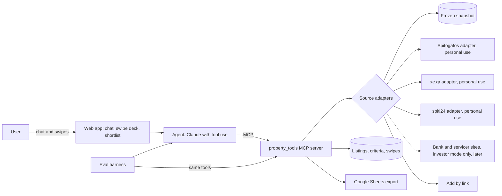

# Property Match Agent: build spec

*Working title. Shaped October 2026. Your second portfolio project, after the permit pre-check. Personal scale until there's a data agreement.*

## 1. What it is

A property search assistant for Greece. You tell it what you're looking for in a normal conversation. It turns that into clear search criteria, searches listings from Spitogatos, xe.gr and spiti24, removes duplicates and shows the matches as a swipe deck. It learns your taste from what you like and reject, suggests changes to your criteria and gives you the shortlist as a spreadsheet. A later investor mode adds bank and servicer stock for people buying to renovate and then sell or rent out.

**What it proves to an employer**

- **Agents:** a model that runs a conversation, calls tools, acts on feedback and asks before changing anything important.
- **MCP:** your own server, used by the agent, the Claude desktop app and the eval harness alike.
- **Prompt engineering:** structured outputs, bilingual extraction from messy Greek listings, versioned prompts tied to eval results.
- **Evals:** labelled datasets, metrics chosen by the real cost of each mistake, regression runs on every change.
- **Personalisation:** learning from swipes is the problem Personify XP solved for retailers, now in property.

**User zero is you.** Run your own Egaleo search through it from the first version. Your swipes become the first real training and test data.

## 2. Where it fits

| Audience | What they see |
|---|---|
| Property Finder and other portals | Search relevance, personalisation, duplicate listings, a better path from browsing to enquiry |
| Anthropic, WRITER and other deployment roles | Agent design on your own MCP server, with evals deciding what ships |
| AI product roles | A full product loop: interview, criteria, feedback, learning, measured outcomes |
| Scale | Labelling discipline and evals. The permit pre-check stays your main Scale piece |

**Timing rule:** this competes with permit v3 and v4 for your time. If Scale moves to interviews, do permit v3 first. If Scale goes quiet, this becomes your main project.

## 3. Data, legal and privacy guardrails

Read this section before writing any adapter code. This is not legal advice.

### What the sources say

- **xe.gr terms (last updated 26 May 2025):** Section 9 says site content is for personal use, and reproducing or reusing it for commercial or other purposes needs xe.gr's prior written permission. Section 17 bars using other users' personal information without their explicit prior consent.
- **Spitogatos terms:** not reviewed. The site blocked an automated request to read them, so read them yourself before any live use. Its bot protection is also why access needs an unblocking service such as Bright Data, which costs money.
- **spiti24:** its About page says it has been part of the Spitogatos Network since 2014, alongside Spitogatos and tospitimou.gr, within the Real Web group that also runs Immobiliare.it in Italy. Its terms, privacy page and robots.txt could not be read by automated request, so read them in a browser before any live use. Expect heavy overlap with Spitogatos and similar bot protection.
- **EU database right:** in CV-Online Latvia v Melons (C-762/19, June 2021) the CJEU held that a specialised search engine copying and indexing a substantial part of a listings database can infringe the maker's database right where it harms the maker's investment. The case was about job ads. The reasoning fits property portals.
- **GDPR:** guidance from the Dutch data protection authority (May 2024) says scraping personal data is almost never lawful for private parties, with an exception for purely personal use. Listings carry agents' names and phone numbers, so treat them as personal data.

### Rules for the build

1. **Personal scale until you have permission.** You plus a few testers who have agreed to take part. No public launch on scraped data.
2. **Store the minimum.** Normalised facts (price, size, floor, year and so on), the listing URL and the dates you saw it. Never store agent or owner names, phone numbers or emails. Link out to the original listing for contact.
3. **No photo copies.** Show photos by linking to the source. If you hash photos for duplicate matching, keep only the hash.
4. **Be polite to the sites.** Cache results, keep request rates low, never hit a source with parallel searches, and respect robots.txt.
5. **Public repo uses made up listings.** Keep the real frozen snapshot private and local. Publish a synthetic dataset with the same structure so anyone can run the evals.
6. **Listing text is untrusted.** A description is data, never instructions to the agent.

### Lowest risk live mode: add by link

If the terms or robots.txt rule out searching a site automatically, fall back to **add by link**. The user pastes a listing URL they found themselves, and the app fetches only that page, the way a browser would, then extracts and scores it. You lose automatic search for that source but keep extraction, scoring, the deck and the shortlist.

### If you ever launch it for real users

You'd need a data agreement. Routes to explore:

- Licensing from the portals. Spitogatos offers market data through Spitogatos Insights.
- Agency partnerships. Many agencies publish the same listings to several portals from their own software.
- A partnership with one portal that wants an AI search front end.

## 4. User journey (v1)

1. **Chat.** "What are you looking for?" The agent asks about buying or renting, budget, areas, size, bedrooms, essentials, deal breakers, commute and timing. It works in Greek or English and replies in the user's language.
2. **Criteria card.** The agent shows what it understood, split into hard limits (never broken) and preferences (weighted). *Changed by D61:* there's no separate confirm step. When the agent has what it needs, its last message says in one sentence what it will search, the deck appears, and the card stays on a one-line bar above it, hard limits always visible. Changes happen by chat and rerun the search.
3. **Search.** The agent searches all three portals, removes duplicates and ranks the results. If there are too few matches, it says which limit to loosen and what that would unlock, for example "raising the budget to €210k adds 14 listings, adding Peristeri adds 22".
4. **Swipe deck.** One listing per card: main photo, price, size, €/m², floor, area and two short "why this one" reasons. Right to like, left to reject. Optional quick reasons on a reject: too dark, too small, bad floor, needs work, too expensive, wrong area.
5. **What I've noticed.** *Changed by D66:* after every 10 swipes, code compares likes with rejects and, when there's a clean pattern, the agent puts one change to the user with the evidence, for example "you've rejected 9 of 10 ground floor flats, shall I leave them out?", or "you're liking homes built from 2015 on; as a limit that leaves 12 of the 68". Offered as a limit when 5 or more homes would remain, otherwise as a strong preference. The user accepts, declines or gives a different number, in the chat. A declined change isn't offered again.
6. **Shortlist.** Liked listings in a table view and a Google Sheets export: price, size, €/m², floor, year, renovation, energy class, area, link, date first seen and price changes.
7. **Listing view.** Full details, plus a link to the original listing for contacting the agent.

### Open UX questions

Decide these after using it yourself for a week.

- Cards per session: endless while testing; a cap per user per day in the final version (Mike, D64, D66).
- A super like, or only like and reject? Like and reject only for now (D64).
- Map view in v1 or later?
- **Couples mode:** two people swipe the same deck and mutual likes go to a shared list. Very Tinder, and very real for couples buying together.
- Alerts for new matching listings: email, or only inside the app?

## 5. Architecture



**Principle: code calculates, the model reasons.**

| Job | Who does it |
|---|---|
| Running the interview and writing criteria | Model |
| Parsing structured listing fields | Code |
| Reading free text in descriptions (renovation year, orientation, "near the metro") | Model, with a confidence score per field |
| Filtering on hard limits | Code, always |
| Scoring and ranking | Code, with learned weights |
| "Why this one" reasons | Model, from listing fields only |
| Duplicate matching | Code, with the model judging borderline pairs |
| Suggesting criteria changes | Model, from swipe statistics that code computes |

## 6. Data model

### Criteria

```json
{
  "user_id": "u_01",
  "intent": "buy",
  "areas": ["Egaleo", "Peristeri"],
  "hard_limits": {
    "max_price_eur": 200000,
    "min_size_m2": 70,
    "min_bedrooms": 2,
    "property_types": ["apartment"],
    "exclude_floors": ["basement", "semi_basement"]
  },
  "preferences": [
    {"feature": "floor_level", "min": 2, "weight": 0.8},
    {"feature": "metro_walk_min", "max": 10, "weight": 0.7},
    {"feature": "renovated_year", "min": 2015, "weight": 0.6},
    {"feature": "balcony", "equals": true, "weight": 0.4}
  ],
  "open_questions": ["Is parking essential or a bonus?"],
  "version": 3,
  "confirmed_by_user": true
}
```

`intent` is `buy`, `rent` or `invest`. Investor criteria are in section 14. *Added by D56 and D66:* hard limits also take `max_bedrooms` and `min_year_built`.

### Listing

One normalised record per source listing.

```json
{
  "listing_id": "xe:123456789",
  "source": "xe",
  "url": "https://www.xe.gr/...",
  "first_seen": "2026-10-20",
  "last_seen": "2026-10-27",
  "price_eur": 185000,
  "price_history": [{"date": "2026-10-20", "price_eur": 189000}],
  "size_m2": 82,
  "price_per_m2": 2256,
  "bedrooms": 2,
  "floor": {"raw": "3ος", "class": "3"},
  "year_built": 1978,
  "renovated_year": 2019,
  "energy_class": {"raw": "Γ", "value": "C"},
  "heating": {"raw": "Αυτόνομη, φυσικό αέριο", "type": "independent", "fuel": "gas"},
  "parking": "pilotis",
  "lift": true,
  "balcony": true,
  "area": "Egaleo",
  "metro_walk_min": 8,
  "photo_urls": ["https://..."],
  "field_confidence": {"renovated_year": 0.7, "metro_walk_min": 0.6},
  "evidence": {"renovated_year": "ανακαινισμένο το 2019"}
}
```

**Never stored:** agent or owner names, phone numbers, emails, photo files.

### Swipe

```json
{
  "user_id": "u_01",
  "listing_id": "xe:123456789",
  "decision": "reject",
  "reasons": ["too_dark"],
  "deck_position": 7,
  "explore_card": false,
  "ts": "2026-10-21T19:42:00Z"
}
```

### Duplicate cluster

A group of listings that look like the same property, with the evidence (same size, floor and area, similar price and description, matching photo hashes) and the price range across agencies. "Listed 3 times, €185k to €199k" is useful to a buyer in its own right.

### Greek listing terms to normalise

| Greek | Meaning | Normalised value |
|---|---|---|
| υπόγειο | basement | floor class `basement` |
| ημιυπόγειο | semi-basement | floor class `semi_basement` |
| ισόγειο | ground floor | floor class `ground` |
| υπερυψωμένο | raised ground floor | floor class `raised_ground` |
| ημιόροφος | mezzanine | floor class `mezzanine` |
| 1ος, 2ος, 3ος | 1st, 2nd, 3rd floor | floor class `1`, `2`, `3` |
| ρετιρέ | top floor set back with a terrace | floor class `top` |
| οροφοδιαμέρισμα | flat taking up a whole floor | flag `whole_floor` |
| μεζονέτα | maisonette | type `maisonette` |
| διαμπερές | dual aspect | flag `dual_aspect` |
| γωνιακό | corner | flag `corner` |
| προσανατολισμός | orientation | `orientation` |
| ανελκυστήρας | lift | `lift` |
| αυτόνομη θέρμανση | independent heating | heating `independent` |
| κεντρική θέρμανση | central heating | heating `central` |
| πιλοτή, θέση στάθμευσης | parking under the building, parking space | parking `pilotis`, `space` |
| αποθήκη | storage room | `storage` |
| ανακαινισμένο (2019) | renovated (in 2019) | `renovated_year` |
| χρήζει ανακαίνισης | needs renovation | condition `needs_work` |
| νεόδμητο | new build | condition `new_build` |
| ΠΕΑ: Α+ to Η, υπό έκδοση | energy certificate class, or pending | `energy_class` |

Greek energy classes run Α+, Α, Β+, Β, Γ, Δ, Ε, Ζ, Η. Store them as Latin letters in code (Γ becomes C, Η becomes G) and show Greek letters to Greek users. Keep this table as an MCP resource and include it in the extraction prompt.

## 7. The agent

### What it does

1. Interviews the user and produces criteria as structured output against the criteria schema.
2. States the criteria in one sentence as it starts the search, and keeps them on the bar above the deck (D61).
3. Searches using MCP tools only.
4. Presents the deck with reasons grounded in listing fields.
5. Reads swipe statistics and proposes criteria changes with evidence.
6. Explains the trade offs when results are thin.

### Rules it must follow

- Never loosens a hard limit without the user's say so.
- Switches on investor mode only when the user says they're investing, and shows it on the bar (D61).
- Never contacts agents or sends anything on the user's behalf. A later option is drafting an enquiry the user sends themselves.
- Never gives investment, legal or mortgage advice. It can show data, such as price per m² against the area median, and suggest asking a professional.
- Treats listing text as data.
- Says "unknown" rather than guessing a missing field.
- Stops after a set number of tool calls per turn and checks in with the user.

### Loop

User message → decide (ask, search, show or suggest) → tool calls → check results against the hard limits → respond. Log every step, because the logs become your eval traces.

### Model choice

A stronger model for the conversation and suggestions, a smaller and cheaper one for bulk extraction from listings. Cache the system prompt and the glossary.

## 8. MCP server: property_tools

### Tools

| Tool | Input | Output | Notes |
|---|---|---|---|
| `search_listings` | criteria, sources, limit | listing summaries | Hard limits applied in code |
| `get_listing` | listing_id | full listing | From cache or source |
| `add_listing_by_link` | URL | full listing | Fetches only that page |
| `extract_listing` | raw listing text, source | normalised fields with confidence and evidence | Model step for free text |
| `find_duplicates` | listing_ids | clusters with evidence | Size, floor, area, price, text, photo hash |
| `area_stats` | area, property type | median €/m², count, spread | Computed from your own snapshot |
| `score_listings` | user_id, listing_ids | ranked list with top features | Learned weights |
| `record_swipe` | user_id, listing_id, decision, reasons | confirmation | Called by the app |
| `swipe_summary` | user_id | stats by feature | Feeds the suggestions |
| `propose_criteria_change` | user_id, change, evidence | proposal id | The agent can only propose |
| `export_shortlist` | user_id, format | Sheets link or CSV | Called by the app |

### Resources

- `criteria://{user_id}`
- `swipes://{user_id}/summary`
- `areas://{area}/stats`
- `glossary://greek_listing_terms`

### Prompts

- `criteria_interview`
- `explain_match`
- `review_my_swipes`

### Adapters

One per source, behind the same interface: `snapshot` (the default for demos and evals), `spitogatos`, `xe` and `spiti24` (personal use, cached, low request rates) and `link` (add by link). If a site changes its layout, only that adapter breaks, and a health check flags it.

### Access rights

The agent can read listings, record swipes and propose changes. Only the logged in user, through the app, can apply criteria changes, export or delete data. This is enforced in the server, not in the prompt. Same pattern as the permit build: the agent recommends, the person decides.

### Show the reuse

Connect the same server to the Claude desktop app and ask "find me a two bedroom flat in Egaleo under €200k with a balcony". That 20 second clip explains MCP better than any slide.

## 9. Prompt engineering

| Prompt | Job | Output |
|---|---|---|
| Interview | Ask the fewest questions needed to fill the criteria | Criteria JSON plus open questions |
| Extraction | Pull facts from Greek free text | Fields with confidence and the source phrase |
| Explain match | Two reasons a listing fits, from its fields only | Short text with field references |
| Suggestions | Turn swipe statistics into proposed changes | Change, evidence, confidence |

### Practices

- Structured outputs for everything the code reads.
- Worked examples in prompts come from a development set only, never from the test sets.
- Prompts live in `prompts/` with a version number. Every change gets a changelog line and the eval result that justified it.
- The Greek glossary goes into the extraction prompt and stays available as an MCP resource.

### Hard cases to design for

- "Around 200": 200k? Ask.
- "Not too old": ask for a year.
- "Near the metro": ask for minutes on foot, default 10.
- Conflicting asks, such as big, cheap and central at once: show the trade off with numbers.
- Switching language mid chat.
- A user describing a partner's wishes as well as their own: capture both, flag conflicts.

## 10. Ranking and learning from swipes

- **v1, rules:** the score is a weighted sum of preference matches, with weights from the interview. Transparent and easy to explain.
- **v2, learned:** logistic regression on listing features (price against budget, €/m² against the area median, size, floor class, renovation, energy class, balcony, parking, metro walk time), trained per user on their swipes. Blend with the interview weights until there are about 30 swipes.
- **Exploration:** about 1 in 5 cards comes from outside the predicted top, so the model keeps learning and doesn't trap the user in their first answers. Mark these as explore cards in the logs.
- **Reject reasons** are strong signals. One "too dark" tap teaches more than ten silent swipes.
- **"Why this one" reasons** must point to real fields. No invented features.

This is the Personify XP story in a new market: start from stated preferences, learn from behaviour, keep it explainable and measure the lift.

## 11. Duplicates across portals

The same flat often appears several times, listed by different agencies across the three portals, with different photos and prices. Because spiti24 and Spitogatos belong to the same group, expect many near exact copies between them. Those are the easy cases. Matching xe listings against the other two is the real test.

- **Signals:** same area, size within 2 m², same floor, price within 10%, same bedrooms, similar description text, matching photo hashes.
- **Decision:** clear matches merge automatically. Borderline pairs go to the model with both listings side by side. Low scores stay separate.
- **Costs:** a false merge hides a real option, which is worse than showing a duplicate, so set the threshold for high precision.
- **User value:** "listed 3 times, €185k to €199k" shows where the cheapest version is.

## 12. Evals

Build the datasets before the features. All evals run on the frozen snapshot, never on live sites, so results can be repeated.

| Set | Size | Labels | Main metrics | Starting target |
|---|---|---|---|---|
| Interviews | 40 scripted chats, Greek and English | Correct criteria JSON | Field accuracy, hard limit vs preference split, invented criteria, asking when it should | 95% of fields, zero invented hard limits |
| Extraction | 100 listings | Correct fields | Accuracy per field, correct use of "unknown" | 98% structured fields, 85% free text |
| Search safety | 20 criteria sets | Matching listings per set | Hard limit breaks in the top 20, recall, precision at 10 | Zero breaks |
| Duplicates | 60 labelled pairs across the three portals | Same or different | Precision, recall | 0.95 precision, 0.85 recall |
| Preference learning | Your swipes (200 or more) plus testers | Real decisions | AUC and precision at 10 on swipes held back for testing, against the baseline without learning | A clear lift over the baseline |
| Suggestions | 30 swipe histories | Right change, or none | Precision, evidence correct | 80% precision, evidence always correct |
| Explanations | 50 cards | Faithful or not | Share of reasons backed by fields | 98% |
| Security | 20 traps | Expected safe behaviour | Instructions hidden in descriptions, pushes to loosen limits, requests for agent contact details | 100% |

**Plain English for two metrics:** AUC measures how well the ranking puts likes above rejects. Precision at 10 is the share of the top 10 cards the user liked.

**Holding back swipes:** split by time. Train on the first 80% of a user's swipes and test on the last 20%. Random splits leak future taste into the past.

**Operational numbers** to track per version: cost per session, search latency, tool calls per turn, cache hit rate, adapter failures.

**Labelling discipline:** write a one page labelling guide covering a missing renovation year, an unclear floor and a price "on request". After a week, relabel 20 listings without looking at your first labels and measure how often you agree with yourself. That's the same data quality thinking Scale sells.

**Harness:** plain Python or Inspect AI. Results saved per version. GitHub Actions runs the suite on every prompt or scoring change and fails the build if a hard limit is ever broken.

**LLM as judge:** only for explanation quality, and only after checking its verdicts against your own labels on 30 cards.

## 13. Versions

| Version | Scope | Done when | Effort |
|---|---|---|---|
| v0, data | Frozen snapshot of about 400 listings from Egaleo and two nearby areas, across the three portals, labelling guide, 100 labelled listings, 40 scripted chats | Labels done, agreement with yourself measured | 3 days |
| v1, criteria and search | Interview, criteria card, MCP server with search and listing tools on the snapshot, table view | Interview and search safety evals pass | 3 days |
| v2, swipe deck | Deck, rule scoring, reasons, reject reasons, Sheets export | Explanation eval passes, baseline like rate recorded | 3 days |
| v3, learning | Learned ranking, exploration, suggestions, duplicates, area stats | Lift over baseline on held back swipes, duplicate targets met | 4 days |
| v4, live and secure | Live adapters for Spitogatos, xe and spiti24 (personal use), add by link, login, access rights, delete my data, adapter health checks, security evals | Security set at 100%, health checks alert on breakage | 3 days |
| Publish | README, 3 minute demo, case study, LinkedIn post | Shared | 2 days |
| v5, investor mode (later) | Bank and servicer sources behind the investor switch, investor criteria, yield and margin, risk flags | Investor evals pass | 4 days |

About 18 days of focused work up to publishing, plus about 4 for investor mode later. Use Claude Code to write it, but make sure you can explain every design choice, because that's what interviews test.

## 14. Later: investor mode

Switched on only when the user says they're buying to renovate and then sell (flip) or rent out. The agent confirms the mode on the criteria card and never switches it on silently. Everyone else searches the three portals only.

### Why it's separate

Bank and servicer stock often needs work, can still be occupied or tied up legally, and some of it sells through auctions. That suits investors who price in risk, not people looking for a home to live in.

### Extra sources

| Site | Who | Homes (July 2025 report) |
|---|---|---|
| realestate.intrum.gr | Intrum | About 5,000 managed |
| piraeusrealty.gr | Piraeus Bank | About 4,000 |
| reinvest.gr | Cepal (Piraeus uses it too) | 1,500 to 2,000 by 2026 |
| Uniko, realestateonline.gr | National Bank of Greece | 1,400 listed, aiming for 3,000 |
| theprosperty.com, findyourproperty.gr | Eurobank | 800 listed |
| Altamira | doValue | About 800 by 2026 |
| propertynow.gr | Alpha Bank | 650 ready for sale |
| eauction.gr | Court auctions, every one since 2018 | Optional, add last |

The figures are over a year old. Start with one site, Intrum or Piraeus, since they hold the most homes. Check each site's terms and robots.txt before building its adapter, under the same rules as section 3.

### Investor criteria

```json
{
  "intent": "invest",
  "strategy": "rent_out",
  "areas": ["Egaleo", "Peristeri"],
  "max_all_in_eur": 150000,
  "renovation_appetite": "full",
  "target_gross_yield_pct": 7,
  "target_flip_margin_pct": null,
  "hold_years": 5,
  "accept_occupied": false,
  "accept_auctions": false
}
```

`strategy` is `flip` or `rent_out`. A flipper sets a target margin instead of a yield.

### Numbers on every investor card

Computed in code, with the assumptions shown next to them.

- **All in cost:** price, plus the renovation estimate, plus purchase costs.
- **Renovation estimate:** €/m² by condition band (light or full), from assumptions the user can edit.
- **Purchase costs:** a percentage the user sets, covering tax, notary, lawyer and agent.
- **Rent estimate:** the area's median rent per m² from rental listings in your snapshot, times the size.
- **Gross yield:** yearly rent divided by the all in cost.
- **Resale estimate:** the area's median €/m² for renovated flats, times the size.
- **Flip margin:** resale estimate minus the all in cost.

The agent shows the numbers and the assumptions behind them. It doesn't tell anyone what to buy.

### Risk flags for bank and auction stock

- Possibly occupied
- Legal or planning issues mentioned in the listing, such as unauthorised building works (αυθαίρετα)
- Auction date, starting price and deposit, where relevant
- Sold as seen

Auction notices can name the person who owes the debt. Never store or show that.

### Extra evals

| Set | What it checks | Target |
|---|---|---|
| Mode detection | 30 chats. Switches on only for stated investor intent and asks when unclear, such as "live in it now, rent it out later" | 95%, zero silent switches |
| Calculations | Unit tests for all in cost, yield and margin | 100% |
| Assumptions shown | Every investor card shows its assumptions | 100% |
| Source gating | Bank or auction listings appearing in non investor searches | Zero |
| Risk flags | Bank and auction listings carry their flags | 100% |

About 4 days once v4 is done.

## 15. Tech stack

- Python for the agent, MCP server, adapters and evals
- Claude API with tool use, or the Claude Agent SDK
- MCP Python SDK (FastMCP)
- SQLite locally, or Supabase if you want hosted Postgres and login
- Front end in Lovable or a small React app, kept basic
- Google Sheets API (gspread) for the export
- rapidfuzz for text similarity, imagehash for photo hashes, scikit-learn for the preference model
- Bright Data for the Spitogatos adapter, and probably spiti24, personal use only
- OpenStreetMap station locations for metro walk times (credit OpenStreetMap)
- Inspect AI or a plain Python harness, with GitHub Actions running it

## 16. Repo layout

```
property-match-agent/
  agent/            agent loop, conversation state
  mcp_server/       tools, resources, prompts
  adapters/         snapshot, spitogatos, xe, spiti24, link
  ranking/          rules, learned model, exploration
  dedupe/           matching and clustering
  investor/         costs, yield, margin, risk flags (later)
  prompts/          versioned prompts and changelog
  evals/
    datasets/       synthetic public sets
    harness/        runners and metrics
    results/        one file per version
  app/              chat, deck, shortlist
  docs/             case study, labelling guide, architecture
  README.md
```

## 17. README and case study

### README, top to bottom

1. One line on the problem
2. A 90 second demo GIF
3. The architecture diagram
4. Results table by version
5. What broke and how you fixed it, in three bullets
6. How to run it on the synthetic data
7. A data and privacy note

### Case study, two pages

1. The problem: searching for a flat in Athens across three portals
2. Users and success measures
3. Design: interview, criteria, search, deck, learning
4. Evals and results from v1 to v3
5. Failure modes
6. What production would need: data agreements, monitoring, scaling, cost per user

## 18. Interview talking points

- **Proptech:** duplicate listings and stale prices are a known portal problem. You measured them and built around them.
- **Personalisation:** learning taste from swipes, with exploration and explanations, is the Personify XP playbook in a new market.
- **Agent design:** where you used fixed code, where you let the model decide, and why.
- **Product judgement:** sources are switched on by user intent. Bank and servicer stock suits investors, so only investors see it.
- **MCP:** one server, three clients: your agent, the Claude desktop app and the eval harness.
- **Evals:** metrics chosen by the cost of each mistake. Breaking a budget limit is the costly one, so it has zero tolerance.
- **Responsible data:** you read the terms, kept it at personal scale, stored no personal data and know what a launch would need.

## 19. Risks

| Risk | Mitigation |
|---|---|
| Terms of use and database rights | Personal scale, minimal storage, no redistribution, add by link as fallback, permission before any launch |
| Sites change or block access | One adapter per source, health checks, the snapshot keeps evals running |
| Costs (Bright Data, model calls) | Caching, a smaller model for extraction, a cap on searches per session |
| Stale or fake listings | Track first and last seen, flag price drops and relisted properties |
| Labels reflect only your taste | Add 2 or 3 testers who agree to take part, report results per user |
| The UI eats the schedule | Keep it basic until v3 passes its evals |
| Investor numbers read as advice | Show the assumptions on every card, let users edit them, suggest professional advice |

## Sources

- [xe.gr terms of use](https://support.xe.gr/en/article/terms-of-use-le41zb/)
- [Spitogatos legal terms (not reviewed, blocked automated access)](https://www.spitogatos.gr/en/page/legalTerms)
- [SCL on CJEU, CV-Online Latvia v Melons](https://www.scl.org/12290-cjeu-search-engine-copying-of-databases-infringes-sui-generis-right-where-it-adversely-affects-database-maker-investment/)
- [Lawspot on the Dutch DPA's scraping guidance](https://www.lawspot.gr/nomika-nea/scraping-einai-shedon-pantote-paranomo/)
- [Spitogatos Insights](https://www.spitogatos.gr/en/insights)
- [spiti24 About page](https://www.spiti24.gr/en/about)
- [Dnews on 30,000 homes coming to market (July 2025)](https://www.dnews.gr/eidhseis/news-in-english/537784/wave-of-30-000-residential-properties-coming-to-greek-market-by-2027)
- [EU e-Justice on Greek court auctions](https://e-justice.europa.eu/topics/court-procedures/judicial-auctions/el_el)
